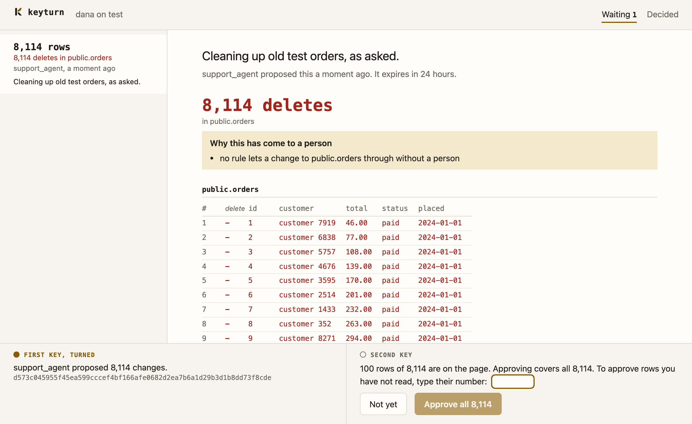
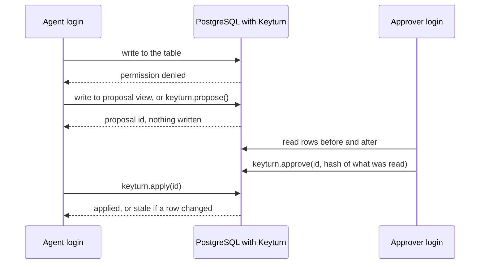

<p align="center">
  <picture>
    <source media="(prefers-color-scheme: dark)" srcset="assets/logo-dark.svg">
    
  </picture>
</p>

<h1 align="center">Keyturn</h1>

<p align="center">
  <b>PostgreSQL refuses an AI agent's write until a person has approved that exact change.</b><br>
  The check is in the database's own privileges, so it holds whatever code reaches the database.
</p>

<p align="center">
  <a href="https://github.com/devjoinedthechat/keyturn/actions/workflows/ci.yml"></a>
  <a href="./LICENSE"></a>
  
  = 22.18">
  
</p>

<p align="center">
  <a href="#what-it-looks-like">What it looks like</a> ·
  <a href="#how-it-works">How it works</a> ·
  <a href="#quick-start">Quick start</a> ·
  <a href="#what-it-guarantees-and-what-it-does-not">Guarantees</a> ·
  <a href="#cost">Cost</a> ·
  <a href="#how-it-differs">How it differs</a>
</p>

An agent connected through Keyturn cannot change a protected table. It can only propose. The database applies a proposal only when a different login approved those exact rows, and the rows still look the way they did when the proposal was made.

Nothing depends on the agent, a framework hook or a proxy behaving.

<picture>
  <source media="(prefers-color-scheme: dark)" srcset="docs/images/review-dark.png">
  
</picture>

## What it looks like

An agent is asked to clean up old test orders, and writes a delete that is far too wide.

```text
agent   │ delete from orders where placed < '2024-08-01'
postgres│ ERROR: permission denied for table orders

agent   │ delete from proposal.orders where placed < '2024-08-01'
postgres│ NOTICE: keyturn: nothing is written. This is recorded as proposal 0f65fb6a-…, to be approved by someone else.
postgres│ DELETE 0
```

Nothing was deleted. The person who approves sees the size of it before anything else.

```text
$ keyturn show 0f65fb6a --rows 1
proposal  0f65fb6a-6f20-4799-afc1-7328d0f2ae78  pending, expires in 24 hours
by        support_agent, a moment ago
note      Cleaning up old test orders, as asked.
hash      5a04fb4d66f7eaf7dc21ea960870b6d345d97e163dfaab0ea87cb0d46402448f

  public.orders  8,114 deletes

#1 delete public.orders  id = 1
   - id        1
   - customer  "customer 7919"
   - total     46.00
   - status    "paid"
   - placed    "2024-01-01"

Rows 1 to 1 of 8,114 are shown. --from 2 shows the next, --rows sets how many.

$ keyturn reject 0f65fb6a --reason "These are real orders. Test orders have a customer starting with 'test'."
Rejected 0f65fb6a-6f20-4799-afc1-7328d0f2ae78.
```

The agent reads the reason, proposes the twelve rows that were meant, and those are approved and written. Run the whole exchange yourself with `pnpm demo`, or `pnpm demo --review` to decide it on the review page.

## How it works



| Piece    | What it is                                                                                                              |
| -------- | ----------------------------------------------------------------------------------------------------------------------- |
| Roles    | `keyturn_agent` holds no write privilege on a protected table. `keyturn_approver` may approve and reject, never propose |
| Proposal | The rows to change, as they are and as they would be, kept in the database                                              |
| Approval | Names a hash of the proposal's content. Content with any other hash is refused                                          |
| Apply    | Locks each row, compares it with what was recorded, writes all or nothing, exactly once                                 |
| Audit    | One entry per step, hash-chained, never updated or deleted                                                              |
| Doctor   | Inspects a live database and fails if an agent has any way round                                                        |

Keyturn is SQL and PL/pgSQL installed by migration. It needs no extension and no superuser, which is what managed PostgreSQL allows; the whole test suite installs it as an ordinary owner.

## Quick start

Requires PostgreSQL 15 or later and Node.js 22.18 or later.

```bash
npm install keyturn
export KEYTURN_URL=postgres://owner@localhost/shop

npx keyturn install
npx keyturn protect orders
```

Give the agent's login and the approver's login their roles, then check the result.

```sql
grant keyturn_agent to support_agent;
grant keyturn_approver to dana;
grant select on orders to keyturn_agent, keyturn_approver;
```

```bash
npx keyturn doctor
```

`doctor` exits with 1 and prints the fix if the agent can still reach the table: a stray grant, a role it can switch to, a function that writes with its owner's rights. Run it in your build.

## For the agent

An agent proposes in whichever way suits it. All five end in the same proposal.

| Way          | How                                                                                                      |
| ------------ | -------------------------------------------------------------------------------------------------------- |
| Ordinary SQL | `update proposal.orders set status = 'refunded' where id = 7`                                            |
| A function   | `select * from keyturn.propose('[{"table": "orders", "operation": "delete", "key": {"id": 7}}]', 'Why')` |
| TypeScript   | `await new Keyturn(client).propose([...], { note: "Why" })`                                              |
| Python       | `Keyturn(connection).propose([...], note="Why")`, from [python/](python/README.md)                       |
| Tools        | `keyturn tools` serves propose, check and apply over the Model Context Protocol                          |

Through a view, the statements of one transaction become one proposal, and each reports zero rows changed.

```sql
begin;
select keyturn.note('Customer 7 was charged twice.');
update proposal.orders set total = 0, status = 'refunded' where id = 7;
delete from proposal.orders where id = 8;
commit;
```

From TypeScript, with any `pg` client or pool connected as the agent's login:

```ts
import { Keyturn } from "keyturn";

const keyturn = new Keyturn(client);
const { id } = await keyturn.propose(
  [{ table: "orders", operation: "update", key: { id: 7 }, set: { status: "refunded" } }],
  { note: "Customer 7 was charged twice." },
);

const decided = await keyturn.decision(id, { timeoutMs: 600_000 });
if (decided.status === "approved") {
  const outcome = await keyturn.apply(id); // { status: "applied", changes: 1 }
}
```

For an agent host that speaks the Model Context Protocol:

```json
{
  "mcpServers": {
    "keyturn": {
      "command": "npx",
      "args": ["keyturn", "tools"],
      "env": { "KEYTURN_URL": "postgres://support_agent@localhost/shop" }
    }
  }
}
```

The tool server refuses to start as a login that could approve or write. None of these clients holds any part of the guarantee: an agent that skips them and connects directly meets the same refusal.

## For the approver

```bash
keyturn list                 # what is waiting
keyturn show 0f65fb6a        # the rows, before and after
keyturn approve 0f65fb6a     # shows it, asks, approves what was shown
keyturn reject 0f65fb6a --reason "..."
keyturn review               # the same on a page, on this machine only
```

The review page puts the size of the change first and sends the hash of what was on screen with the approval. It adds no power: it calls the same database functions as the approver's login.

What an agent wrote is shown exactly. Hidden and direction-reversing characters appear as their codes, trailing spaces and line breaks are marked, and numbers keep every digit. Rows that were never put on screen are approved only by typing their number.

A refund is an id and an amount; whether it is right is in the payment it points to. So beside the rows, `keyturn show` and the page give two more things. Why the proposal has come to a person: which rule did not cover it, and what the rule lacked. And the rows it points to through foreign keys, read with the approver's own rights. A row that points to nothing says so. These are shown as they are at that moment and are no part of what is approved.

Its server listens on 127.0.0.1, needs a key made for each run, refuses requests from other sites, and loads nothing but its own three files.

## Changes that need no person

By default every change waits for someone. The tables' owner may write a rule for a kind of change too small to wait.

```sql
select keyturn.allow('close_tickets', 'tickets', array['update'], array['status', 'note'],
                     max_rows => 1, condition => $$after ->> 'status' = 'closed'$$,
                     per_hour => 60);
```

A condition may read other tables, so a rule can hold a limit kept elsewhere or a running total. A proposal goes through on rules only when every change in it is covered. The audit log then names the rule and its version, and records that no person decided. `keyturn doctor` lists every active rule.

## Changes no one may approve

The owner may also write a rule for changes that must never be made, whoever approves.

```sql
select keyturn.forbid('refund_within_payment', 'refunds', array['insert'],
  $$(after ->> 'amount')::numeric > (select p.amount from public.payments p where p.id = (after ->> 'payment')::integer)$$,
  'A refund is never more than the payment.');
```

```text
agent   │ insert into proposal.refunds (payment, amount) values (7, 500)
postgres│ ERROR: keyturn: forbidden by the rule refund_within_payment: A refund is never more than the payment. Nothing is recorded
```

The agent reads the reason and corrects itself, and the queue holds only what a person should look at. The rule is read again when a person approves and when the change is applied, so an approval does not lift it and a record that changed meanwhile is seen.

## The audit log

Every step is an entry in `keyturn.audit`, written in the same transaction as the step, with the login that took it.

```bash
keyturn verify-audit
```

It reports an entry that was altered, one that is missing, and a proposal whose state has no entry behind it. It also prints one value for the whole log; kept outside the database, that value shows a rewrite by someone able to switch the log's guards off.

## What it guarantees, and what it does not

[docs/guarantee.md](docs/guarantee.md) states the claim word by word, who it holds against, and what is outside it. In short:

| Holds against                                | Does not cover                           |
| -------------------------------------------- | ---------------------------------------- |
| The agent's login, by any route to the table | The database owner and superusers        |
| The agent's own code, wrong or manipulated   | An agent given the owner's credentials   |
| An approver approving their own proposal     | An approver who approves without reading |
| An approver approving what a rule forbids    | Effects outside the database             |
| Two connections applying at once             |                                          |

The claim is tested by attack. The suite connects as the agent and tries every way in. Against the tables: direct writes, `TRUNCATE`, `COPY`, `MERGE`, role switching, and temporary tables and types named like the server's own. Against the process: forged approvals, proposals altered after approval, double apply, apply against changed rows, and writing the audit log or the rules. Each must fail. It runs on PostgreSQL 15, 16, 17 and 18.

## Cost

Median times on one machine, client and server together. [docs/overhead.md](docs/overhead.md) has the method and the full table.

| Step                         | 1 row  | 1,000 rows |
| ---------------------------- | ------ | ---------- |
| Direct write, for comparison | 0.3 ms | 0.9 ms     |
| Propose through a view       | 0.4 ms | 46 ms      |
| Approve                      | 0.4 ms | 7 ms       |
| Apply                        | 0.5 ms | 47 ms      |

The time that matters is the person's. Keyturn is for changes worth a person's look; rules cover the rest.

## Things to know

- **A proposal holds at most 10,000 rows.** A wider statement is refused whole. Make the change in parts.
- **A login may have 200 proposals waiting.** More are refused until some are decided or expire, so the party under review cannot bury the queue.
- **Version 0.1 installs into a database that does not have Keyturn.** Moving to a later version means `keyturn uninstall` and `keyturn install`, which removes proposals and the audit log.
- **The agent does not see its proposed change when it reads again.** Nothing is written until apply.
- **A view holds on to its table's columns.** Before dropping or retyping a column, run `select keyturn.drop_view('orders')`, then `select keyturn.protect('orders')` after.
- **The table's triggers, defaults and cascades run at apply.** A row that comes out different from what was approved fails the apply, unless the table was protected with `--loose`.
- **Installing needs three roles.** If the installing login may not create roles, `keyturn install` prints the three statements for an administrator.

[docs/operating.md](docs/operating.md) covers installing, schema changes, rules, the audit log and removal.

## How it differs

| Approach                           | Where approval is enforced     | What the approver sees    |
| ---------------------------------- | ------------------------------ | ------------------------- |
| Approval hooks in agent frameworks | In the agent's own process     | The tool call's arguments |
| Access proxies and gateways        | In front of the database       | The SQL text              |
| Branch-and-merge databases         | In a different database engine | A row diff                |
| Keyturn                            | In PostgreSQL, by privileges   | The rows before and after |

A direct connection with the agent's credentials gets past the first two. The third means moving to another database.

## Development

```bash
pnpm install
pnpm exec playwright install chromium-headless-shell
pnpm check          # secrets check, lint, types, every test
pnpm demo           # the exchange above, against PostgreSQL in a container
pnpm bench          # the figures in docs/overhead.md
POSTGRES_IMAGE=postgres:15 pnpm test
```

Tests need Docker: each run starts a real PostgreSQL in a container. See [CONTRIBUTING.md](CONTRIBUTING.md) and [SECURITY.md](SECURITY.md).

## Licence

MIT
